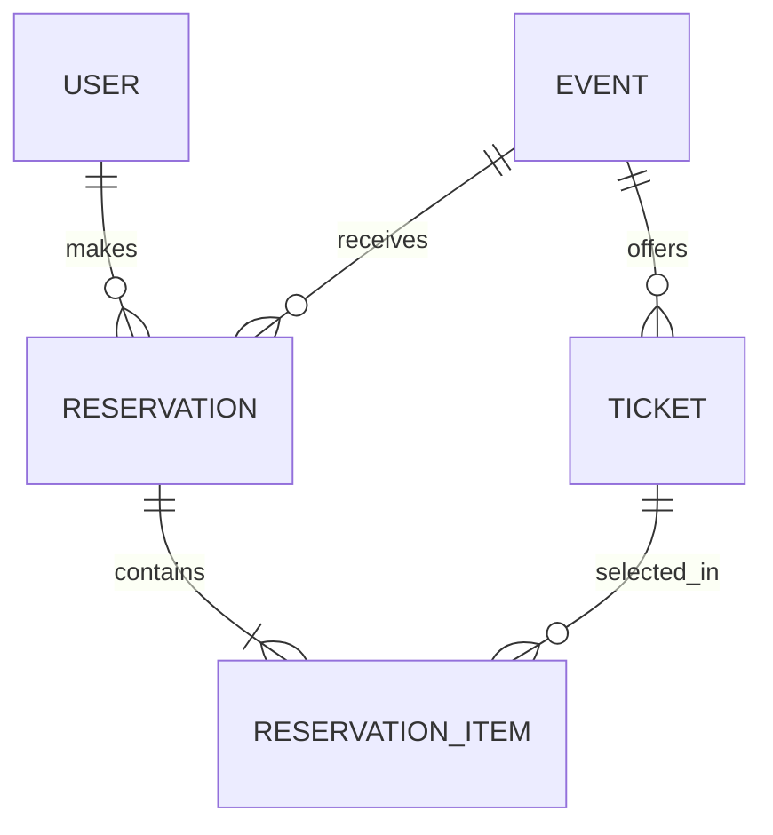

# ReserveFlow

**Concurrency-safe ticket reservation API built with Java 21, Spring Boot, JPA/Hibernate and PostgreSQL 17.**

ReserveFlow manages events, ticket inventory and reservations. It was built to solve three connected backend problems: **overselling under concurrent requests**, **consistent cancellation across related records**, and **efficient reservation pagination with JPA**.

## Engineering highlights

| Challenge | Engineering decision | Verified outcome |
| --- | --- | --- |
| Competing bookings for the last ticket | Optimistic locking with `@Version` on `Ticket` | Concurrent transactions produce one successful stock update and one version conflict |
| Reservations racing with event cancellation | `PESSIMISTIC_READ` for reservation operations, `PESSIMISTIC_WRITE` for event cancellation | Four concurrent cancellation scenarios verify final reservation status and inventory |
| N+1 queries and paginated association loading | Targeted fetch joins, Hibernate batch fetching and database-level pagination | Event–Ticket investigation: **51 → 1 SELECT**; reservation page: **20 results in 4 SQL statements** |

**Stack:** Java 21 · Spring Boot 4.1.1 · Spring Data JPA · Hibernate 7.4.5 · PostgreSQL 17 · Gradle · Docker Compose · JUnit 5

## Engineering case study: from N+1 queries to correct pagination

### 1. Reproducing the N+1 problem

Accessing `Event.tickets` after loading events caused separate lazy-loading queries for each event. I captured the generated SQL to make the problem measurable: **one event query followed by 50 ticket queries (51 SELECTs)**.

Switching the Event–Ticket read to `LEFT JOIN FETCH` loaded the required association in **one SELECT**. Both SQL traces and screenshots are available below.

| Event–Ticket query | SELECTs recorded | Evidence |
| --- | ---: | --- |
| Event list followed by lazy ticket access | **51** | [SQL](docs/performance/n-plus-one-before.txt) · [Screenshot](docs/performance/n-plus-one-before.png) |
| Event–Ticket `LEFT JOIN FETCH` | **1** | [SQL](docs/performance/n-plus-one-after.txt) · [Screenshot](docs/performance/n-plus-one-after.png) |

### 2. Discovering the collection fetch-join pagination problem

When implementing the reservation listing, an earlier repository query, `findAllWithDetails(Pageable)`, fetch-joined `Reservation.event`, `Reservation.reservationItems` and `ReservationItem.ticket` together.

That approach eagerly loaded the response graph, but introduced a different problem: **fetch-joining a to-many collection in a paginated query can multiply rows and cause Hibernate to paginate in memory rather than apply the page limit in SQL**. Loading all reservation items was the wrong trade-off for a pageable endpoint.

### 3. Separating page selection from association loading

I replaced the collection fetch-join page query with `findAllWithEvent(Pageable)`:

- **To-one fetch join:** fetch `Reservation.event` in the main reservation query.
- **Database pagination:** apply `ORDER BY` and `FETCH FIRST 20 ROWS ONLY` to the reservation rows in PostgreSQL.
- **Batch fetching:** load `ReservationItem` and `Ticket` associations in batches using `hibernate.default_batch_fetch_size=20`.
- **DTO mapping inside the service:** map the returned page while the service transaction is active, with OSIV disabled.

This keeps the collection out of the paginated fetch join while avoiding a query per reservation item.

### 4. Measuring the final query plan

On **19 October 2026**, `ReservationPaginationPerformanceTest` created 20 reservation fixtures, flushed and cleared the persistence context, reset Hibernate Statistics, and measured the page read on PostgreSQL 17.

| Measurement | Result |
| --- | ---: |
| Reservations in the test transaction | 85, including 20 test-created reservations |
| Requested page | 20 reservations |
| Prepared SQL statements for the read | **4** |

The four statements were a paginated Reservation–Event query, a count query, a batch query for reservation items, and a batch query for tickets. The test verifies the returned reservation IDs and asserts an SQL count of **at most five**; its fixtures are rolled back afterward.

**Implementation:** [ReservationRepository](src/main/java/com/yejun/ticketreservation/repository/ReservationRepository.java) · [ReservationService](src/main/java/com/yejun/ticketreservation/service/ReservationService.java) · [SQL-count integration test](src/test/java/com/yejun/ticketreservation/performance/ReservationPaginationPerformanceTest.java)

## Concurrency and data consistency

### Preventing ticket overselling

Two requests can read the same remaining stock before either transaction commits. A stock check alone cannot resolve this race.

`Ticket` uses JPA `@Version` to reject conflicting updates. The concurrency tests start with **one ticket** and execute two competing transactions, checking the version conflict and final stock. The reservation-level test also verifies that only one reservation was persisted. An optimistic locking conflict is returned as **HTTP 409 Conflict**.

**Implementation:** [Ticket](src/main/java/com/yejun/ticketreservation/domain/Ticket.java) · [ReservationService](src/main/java/com/yejun/ticketreservation/service/ReservationService.java)

**Tests:** [TicketConcurrencyTest](src/test/java/com/yejun/ticketreservation/concurrency/TicketConcurrencyTest.java) · [ReservationConcurrencyTest](src/test/java/com/yejun/ticketreservation/concurrency/ReservationConcurrencyTest.java)

### Coordinating reservation and event cancellation

Ticket versioning protects stock updates, but does not by itself coordinate bookings with an event's lifecycle. ReserveFlow therefore uses locks on the shared `Event` row:

- **`PESSIMISTIC_READ`** when creating or cancelling an individual reservation.
- **`PESSIMISTIC_WRITE`** when cancelling an entire event.

Event cancellation changes the event status, cancels confirmed reservations and restores the associated inventory in one transaction. Four integration tests exercise competing execution orders, including reservation versus event cancellation and individual versus event-wide cancellation.

**Implementation:** [EventRepository](src/main/java/com/yejun/ticketreservation/repository/EventRepository.java) · [EventService](src/main/java/com/yejun/ticketreservation/service/EventService.java)

**Tests:** [EventCancellationLockTest](src/test/java/com/yejun/ticketreservation/concurrency/EventCancellationLockTest.java)

### Transaction boundaries

Mutations run in service-layer `@Transactional` methods. DTO mapping also occurs within the service boundary, with `spring.jpa.open-in-view=false` to keep entity loading out of controller response serialization.

## Data model



A reservation belongs to **one user and one event** and contains one or more items. Each reservation item stores a ticket, quantity and unit price. An event offers `GENERAL` and/or `VIP` tickets, with a unique constraint on `(event_id, ticket_type)`. Ticket quantities and prices are validated at the API/domain boundaries.

## REST API

| Resource | Operations |
| --- | --- |
| Users | `POST /users`, `GET /users`, `GET /users/{id}`, `DELETE /users/{id}` |
| Events | `POST /events`, `GET /events`, `GET /events/{id}`, `PUT /events/{id}`, `PATCH /events/{id}/cancel` |
| Reservations | `POST /reservations`, `GET /reservations`, `GET /reservations/{id}`, `PATCH /reservations/{id}/cancel` |

Both event and reservation listings support Spring Data pagination, for example:

```http
GET /reservations?page=0&size=20&sort=id,asc
```

### Example reservation flow

**1. Create a user — `POST /users`**

```json
{"name": "Demo User", "email": "demo@example.com"}
```

**2. Create an event with ticket inventory — `POST /events`**

```json
{
  "title": "Demo Event",
  "venue": "Demo Hall",
  "startTime": "2030-01-01T19:00:00",
  "tickets": [{"ticketType": "GENERAL", "price": 60.00, "totalQuantity": 10}]
}
```

**3. Book a ticket — `POST /reservations`**

```json
{
  "userId": 1,
  "eventId": 1,
  "items": [{"ticketId": 1, "quantity": 1}]
}
```

Use the IDs returned by the preceding requests, and select a future event start time.

## Run locally

**Prerequisite:** Docker Desktop, or Docker Engine with Docker Compose.

**Windows PowerShell**

```powershell
$env:DB_PASSWORD="choose_your_own_local_password"
docker compose up --build
```

**macOS / Linux**

```bash
export DB_PASSWORD="choose_your_own_local_password"
docker compose up --build
```

The API starts at **http://localhost:8080**. Docker Compose builds the Spring Boot service and starts PostgreSQL 17 with persistent storage in a named volume. A new database has no seed records; create users and events through the API. Hibernate manages the local demo schema with `ddl-auto: update`.

## Verification

The PostgreSQL-backed test suite covers optimistic locking, competing reservations, four event-cancellation races, and query counts for paginated reads. **All eight tests passed with Gradle on 19 October 2026.**

| Test | What it verifies |
| --- | --- |
| [TicketConcurrencyTest](src/test/java/com/yejun/ticketreservation/concurrency/TicketConcurrencyTest.java) | Stock version conflict and final inventory |
| [ReservationConcurrencyTest](src/test/java/com/yejun/ticketreservation/concurrency/ReservationConcurrencyTest.java) | Competing bookings and persisted reservation count |
| [EventCancellationLockTest](src/test/java/com/yejun/ticketreservation/concurrency/EventCancellationLockTest.java) | Four event/booking cancellation race scenarios |
| [ReservationPaginationPerformanceTest](src/test/java/com/yejun/ticketreservation/performance/ReservationPaginationPerformanceTest.java) | Page contents and bounded SQL statement count |
| [TicketReservationApplicationTests](src/test/java/com/yejun/ticketreservation/TicketReservationApplicationTests.java) | Spring application context |

For host-side Gradle tests, provide `DB_URL`, `DB_USERNAME`, and `DB_PASSWORD` pointing to an accessible **test PostgreSQL database** and run:

```powershell
.\gradlew.bat test --no-daemon
```

The Compose PostgreSQL container is internal to the Docker network, so host-side Gradle tests should use a separately accessible test database.
